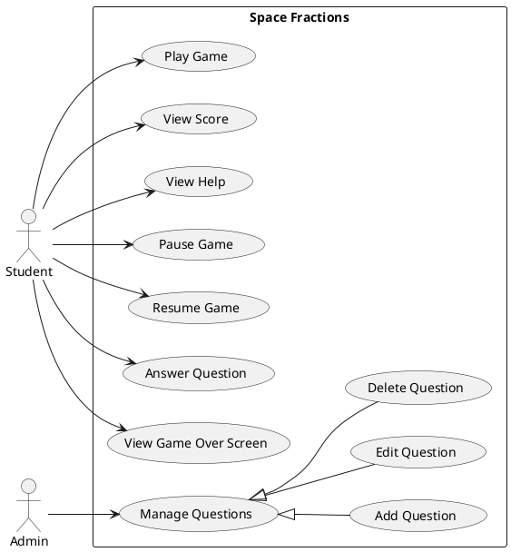
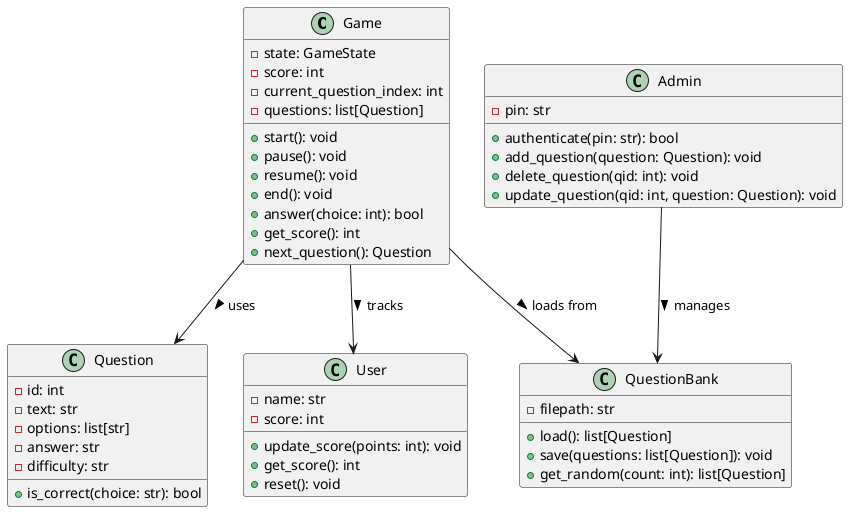
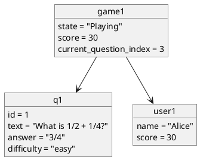
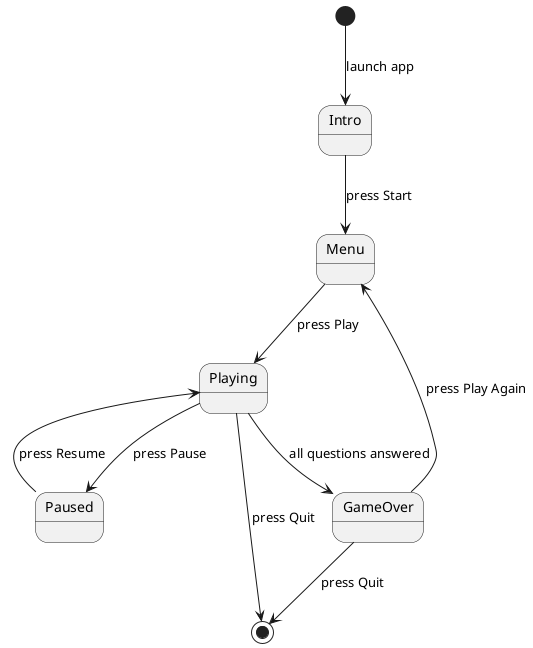
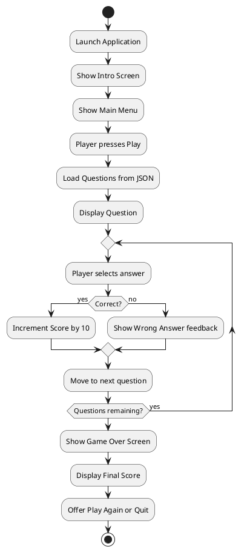
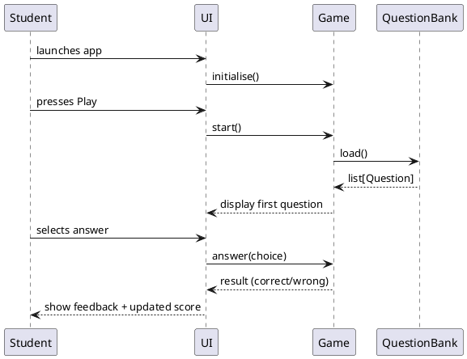
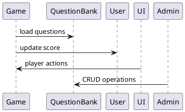
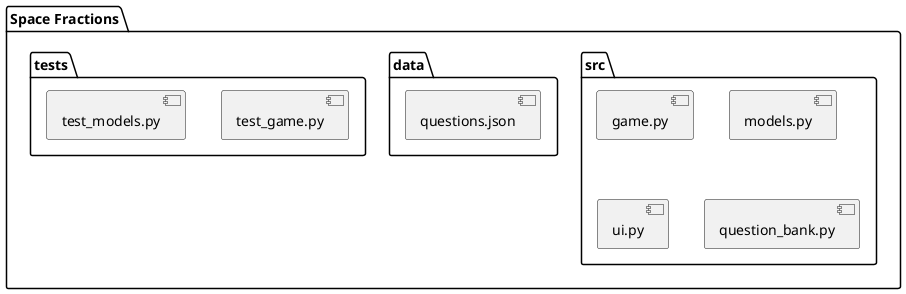
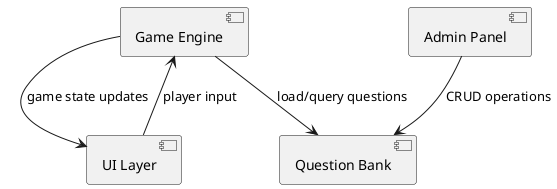
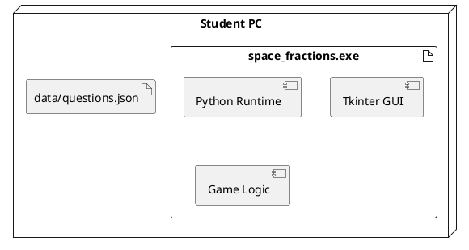

# Architecture View – Space Fractions
PlantUML diagrams for the Space Fractions educational game.

---

## Use Case Diagram



---

## Class Diagram



---

## Object Diagram



---

## State Diagram



---

## Activity Diagram



---

## Sequence Diagram



---

## Collaboration Diagram



---

## Package Diagram



---

## Component Diagram



---

## Deployment Diagram



---

## Container Diagram

```plantuml
@startuml ContainerDiagram
Person(student, "Student", "6th grade player")
Person(admin, "Admin", "Teacher/admin")

Container(app, "Space Fractions Desktop App", "Python + Tkinter", "Desktop GUI application")
ContainerDb(db, "Question Bank", "JSON file", "Stores fraction questions")

student --> app : plays
admin --> app : manages questions
app --> db : reads/writes questions
@enduml
```
